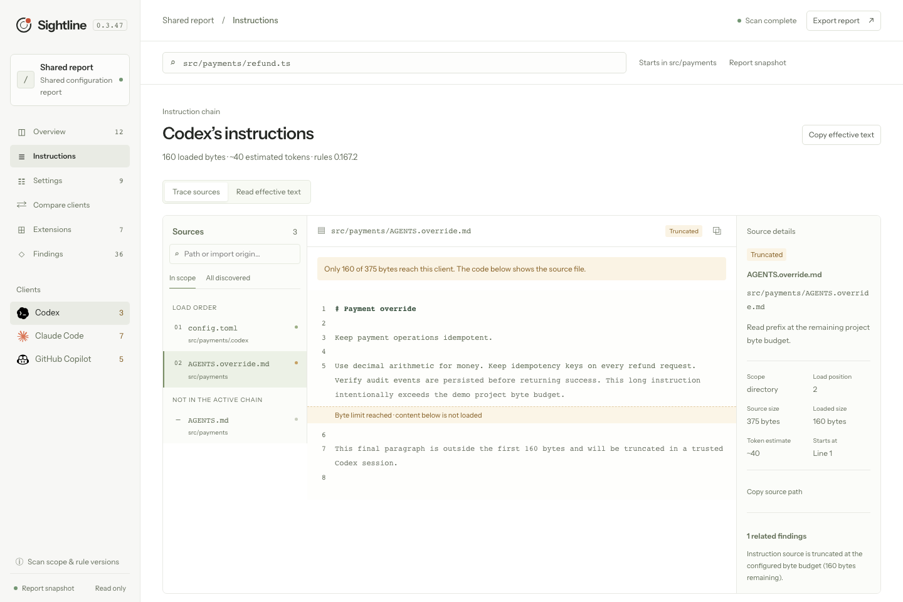

# Agent Sightline

[English](README.md) | [简体中文](README.zh-CN.md) | [日本語](README.ja.md)

**コーディングエージェントが実際に読み込む設定を確認。**

同じリポジトリでも、Codex、Claude Code、GitHub Copilot が読み込む指示、設定、拡張機能は異なります。Sightline は読み込み順序、適用理由、上書きの関係、元ファイルの行を表示し、設定ミス、参照切れ、指示の切り詰めを調べるためのツールです。

## プロジェクトで使う

Node.js 22 以降が必要です。プロジェクトのディレクトリでターミナルを開き、次のコマンドを実行します。

```sh
npx --yes https://github.com/iamzwxyy/agent-sightline/releases/download/v0.3.47/agent-sightline-0.3.47.tgz ui
```

ブラウザーにローカルの検査画面が開きます。まず Findings で診断結果を選び、原因と修正案を確認します。Inspect source を押すと、元ファイルの該当行に移動できます。対象ファイルの選択欄から、リポジトリ内の別のファイルも検査できます。アプリの画面と診断メッセージは英語です。

付属のサンプルでは、指示の切り詰め、参照先の欠落、ルールの優先順位、拡張機能の設定エラーを確認できます。[ブラウザーデモ](https://iamzwxyy.github.io/agent-sightline/demo/)



## CLI をインストールする

繰り返し使う場合はグローバルにインストールできます。続けて付属サンプルを開くには、次のコマンドを実行します。

```sh
npm install -g https://github.com/iamzwxyy/agent-sightline/releases/download/v0.3.47/agent-sightline-0.3.47.tgz
agent-sightline demo --ui
```

公開パッケージは GitHub Releases で配布しており、実行時の依存パッケージも含まれています。ダウンロード済みのファイルからはオフラインでインストールできます。

```sh
npm install -g --offline ./agent-sightline-0.3.47.tgz
```

npm レジストリへの初回公開は、アカウント認証の完了待ちです。[リリース一覧とダウンロード](https://github.com/iamzwxyy/agent-sightline/releases)

## よく使う操作

プロジェクトのディレクトリで実行します。

```sh
agent-sightline
agent-sightline explain . --client codex --trust trusted
agent-sightline diff . --clients codex,claude,copilot --trust trusted
```

`.` をリポジトリ内のファイルパスに置き換えると、そのファイルに適用される設定を検査できます。対象ファイルの親ディレクトリが存在している必要があります。既定では対象のディレクトリから起動する新しいエージェントセッションをモデル化します。リポジトリのルートで実行する場合、`--session-dir .` を加えると、エージェントの起動ディレクトリをルートに固定できます。

通常の検査では最も近い Git ルートを見つけ、相対パスを現在の作業ディレクトリから解決します。`--repo` で検査範囲を明示できます。既定ではリポジトリと、各クライアントについて記録されたユーザー設定の場所を読み込みます。`--no-user` を指定するとリポジトリ内の検査を選択できます。

`--trust trusted` は、リポジトリが信頼済みで、Claude のプロジェクト MCP が承認済みである前提で検査します。既定の Auto では、信頼や承認待ちの読み込みを条件付きとして表示します。この検査上の前提は画面上部でも切り替えられます。

## 比較と共有

Compare clients では、各クライアントに渡る有効な指示、行単位の差分、設定元、拡張機能の定義を比較できます。Settings では、採用された設定値と上書きされた定義を確認できます。

診断の詳細画面にある Copy diagnosis は、秘匿処理を適用した対象パス、クライアント、元ファイルの行、原因、修正案をコピーします。Export diagnosis report はレポート全体を HTML に書き出し、受け取った人が開くと選択した診断が表示されます。その後も別の設定元や比較結果を確認できます。HTML には画面のコードとデータが含まれ、オフラインでの閲覧と再エクスポートに対応しています。

ターミナルからレポートを書き出したり、診断の重大度に応じて CI の終了コードを決めたりすることもできます。

```sh
agent-sightline report --format html --output report.html
agent-sightline ci --no-user --fail-on warn --json
```

CI の既定の出力は JSON で、error が見つかると終了コード 1 を返します。`--fail-on warn` はしきい値を warning に変更します。検査が成功した場合は 0、入力や検査のエラーは 2 です。[CLI の詳細](docs/cli.md)

## 対応範囲

| クライアント | 現在の検証範囲 |
| --- | --- |
| OpenAI Codex CLI | 記録されたルールについて、ネイティブ CLI との照合とテストフィクスチャで検証 |
| Claude Code | 指示、MCP、権限をネイティブ CLI と照合し、その他の記録されたルールをテストフィクスチャで検証 |
| GitHub Copilot CLI | 設定、指示、拡張機能一覧をネイティブ CLI と照合し、テストフィクスチャで検証 |
| Gemini CLI | 実験的対応。公開された起動・インポート処理との照合を含む |
| Cursor | 実験的対応。記録されたローカルルールと MCP 設定を対象とする |
| OpenCode V2 | 実験的対応。記録された V2 のローカル設定と指示を対象とする |

検証したバージョン、ルールの根拠、制約は次のコマンドで確認できます。[詳しい対応表](README.md#supported-contracts)

```sh
agent-sightline adapters
```

## ローカル実行とプライバシー

v0.3.47 では、指示の切り詰め位置で分断された、識別済みの秘密情報も秘匿します。該当する以前のレポートは再検査して生成し直し、差し替えてください。

既定の検査はローカルで読み取り専用として実行されます。出力時には、識別できた秘密情報に再度秘匿処理を適用し、取得済みのリポジトリ、ホームディレクトリ、設定のエイリアスパスを置き換えます。自由記述の文章には、識別できなかった機密情報が含まれる可能性があるため、共有前にレポートを確認してください。[セキュリティ方針](SECURITY.md)

検査結果は、選択した起動ディレクトリ、対象ファイル、信頼の前提に基づく新しいセッションの入力を表します。実行中のセッション設定、プラグイン、管理ポリシーを扱う範囲は、各アダプターに記録された追加の根拠に従います。Scan scope & rule versions で具体的な制約を確認できます。

以前に書き出した HTML には、その時点の画面コードが含まれています。最新の画面を使うにはレポートを再生成してください。

## コントリビューション

変更内容に応じた検証コマンド、着手しやすい課題、コードの入口、受け入れ条件をまとめています。[コントリビューションガイド](CONTRIBUTING.md) · [初めての課題](docs/good-first-issues.md)

MIT。[ライセンス](LICENSE)
