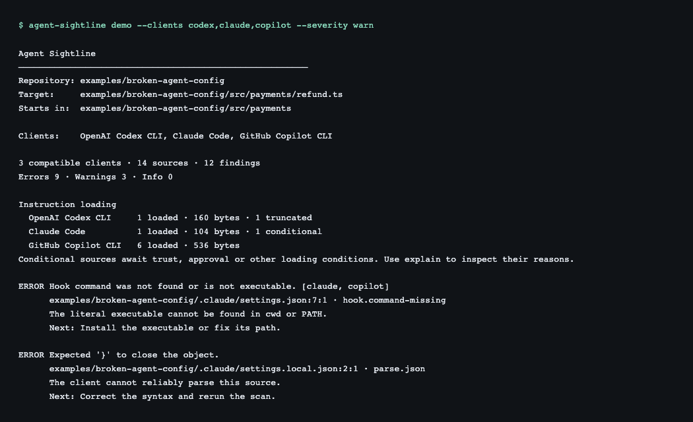
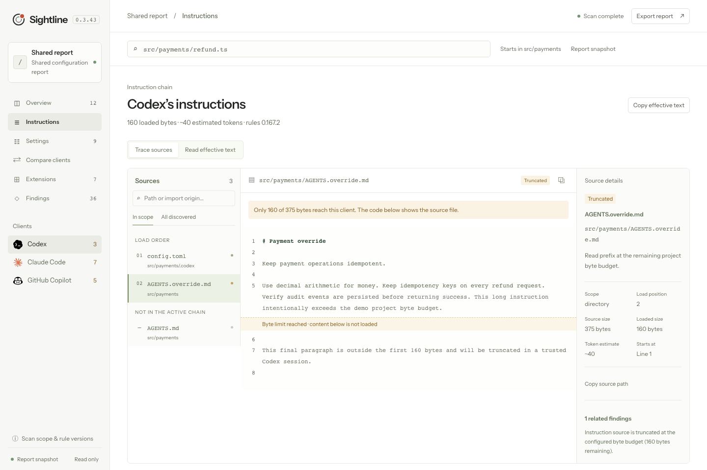

# Agent Sightline

[English](README.md) | [简体中文](README.zh-CN.md)

**See what your coding agent actually sees.**

One file. Several agents. Different instructions. Sightline shows every discovered source, why it applies, what is shadowed or truncated, and the effective configuration—with source lines you can inspect.

Open a terminal in your project folder and run one command to inspect your repository in the browser.

```sh
npx --yes https://github.com/iamzwxyy/agent-sightline/releases/download/v0.3.45/agent-sightline-0.3.45.tgz ui
```

For repeated use, install the CLI. The bundled demo provides a sample workspace with intentional configuration problems.

```sh
npm install -g https://github.com/iamzwxyy/agent-sightline/releases/download/v0.3.45/agent-sightline-0.3.45.tgz
agent-sightline demo --clients codex,claude,copilot --severity warn
agent-sightline demo --ui
```

Node.js 22+. Download and run the package from the public GitHub Release. The website also hosts package downloads. Runtime dependencies are bundled, so a downloaded package installs with `npm install -g --offline ./agent-sightline-0.3.45.tgz`. Public npm-registry publication is pending. [Explore the browser demo](https://iamzwxyy.github.io/agent-sightline/demo/) or read the [installation guide](https://iamzwxyy.github.io/agent-sightline/guide.html).



The demo contains real deterministic failures: a missing instruction import, an import cycle, contradictory allow/deny entries, unavailable MCP and hook commands, missing environment variables, invalid skill metadata and a Codex override that exceeds its byte budget.

```sh
agent-sightline                                      # discover and diagnose this repository
agent-sightline explain src/payments/refund.ts --client codex --trust trusted
agent-sightline diff src/payments/refund.ts --clients codex,claude,copilot --trust trusted
```

Targets can be source files that do not yet exist if their parent directory exists. The explanation models a fresh session launched in the selected starting directory, which defaults to the target’s directory, and opening that file; it does not claim to observe an already-running agent.

The first terminal summary lists loaded instruction sources, effective bytes, conditional sources and truncation for each detected client. In the browser overview, choose **Inspect conditional loading** to open the source and its loading requirements.

Run these commands from any repository subdirectory. Sightline finds the nearest Git root and includes applicable ancestor instructions and project configuration. Relative targets resolve from your current directory. An explicit `--repo` selects the inspection boundary and resolves targets relative to that directory.

Syntax and configuration findings follow each client's target discovery scope. Files from other projects appear in discovered sources with their validity flags and an outside-target explanation. Select a target in their loading chain or inspect their project with `--repo` to diagnose them.

## What it shows

* **Loading proof:** ordered sources with absolute paths, lines, scope, status, reason, loaded bytes and an approximate token cost.
* **Effective inputs:** accumulated instruction bodies, structured setting winners and replaced origins, plus MCP/skill/hook/permission definitions.
* **Deterministic findings:** invalid formats/duplicate keys, override selection, missing/circular/repeated imports, unmatched globs, byte truncation, MCP drift and missing commands/env/cwd, skill conflicts and proven deny/ask permission masking.
* **Comparison:** exact paragraphs grouped by receiving client, original source ranges and repeated loading occurrences, plus extension definitions for each client.
* **Shareable output:** terminal, stable JSON and a redacted standalone HTML inspector, plus CI finding thresholds.

Model an agent launched from the repository root while inspecting a nested file with `agent-sightline explain src/payments/refund.ts --session-dir . --client codex --trust trusted`. The local inspector also lets you choose the starting directory, keep it while changing targets and restore automatic target-directory selection.

Select the same Codex profile used in your agent session with `agent-sightline explain src/payments/refund.ts --client codex --profile review --trust trusted`. This loads `$CODEX_HOME/review.config.toml` after user defaults and before project settings, with winning and replaced source lines. The browser inspector also supports selecting and clearing profiles.

## Local inspector

```sh
agent-sightline ui
agent-sightline report --format html --output report.html
agent-sightline ci --no-user --fail-on warn --json
```



The browser UI has client/source navigation, effective content, provenance explanations, client comparison, finding filters and portable HTML export. Exported reports open at the selected view and source location, including the client, repeated import occurrence, linked line and effective-text mode. It binds to `127.0.0.1`; no Electron or hosted service is involved. `--no-open` prints the URL without opening a browser.

The workspace opens with grouped errors and warnings. Select a finding to read its cause and suggested resolution, then jump to the source line. The source explorer shows the original redacted file with line numbers and the byte cutoff. Find target files by name, path or fuzzy query with ⌘K / Ctrl+K. Use arrow keys and Enter to select a result, or inspect a typed path. Filter sources with `/` and inspect client coverage in the comparison matrix. Trust assumptions can be changed from the top bar. Target and trust changes cancel superseded scans and pending configuration reads.

Read effective text shows the exact accumulated instructions with clickable source origins. Compare clients finds shared paragraphs across different source files, with filters for shared content and different recipients. Each occurrence links to the owning client and source lines. The full instruction text also appears side by side. Settings lets you search resolved values, inspect the selected definition and follow replaced layers. Source jumps bring the selected line into view, and source links retain that line through reload and browser Back/Forward in live and portable reports. Refresh scan retains the selected line in the local inspector. After a successful refresh, the fixed header shows current error and warning counts with a Review findings action. Incomplete discovery links to scan scope. Repeated source rows retain their individual loading decisions and captured import origins. Open an import origin to inspect its declaring line. The selected occurrence survives reload and browser history in live and portable reports. Navigation, export and local inspection controls stay visible while reading long sources. Detail dialogs keep their close control visible during long configuration inspection. The source filename stays in view. Long source lists reveal the selected row while keeping desktop search and filters accessible. Tab enters the source list once. Arrow keys and Home/End move through rows, and Enter selects a source. Source inspection focuses the filename heading, with Shift+Tab returning to the list. Source origins and client entry points clear stale searches. Browser history clears a search that excludes its destination. Wide desktop layouts keep source and explanation panels beside the code. Newly selected views open at their heading and filters. The target and trust choice survive reloads, and browser Back returns through your inspection history. A repository with no configuration opens with a working sample-workspace entry point.

Opened findings have stable diagnostic links. Reload and browser history restore the selected issue. **Copy diagnosis** includes its portable target, clients, location, available source line, reason and suggested resolution. **Export diagnosis report** saves the complete portable report with that issue open for the recipient. Both actions use the last successful inspection, including while files are being edited.

MCP extension details link each configured field to its contributing file and line. A Codex server can inherit its command from user settings and its arguments from a project layer. Findings and terminal explanations retain those separate origins. Terminal explanations and comparisons include each extension’s loading reason.

Line-by-line comparison aligns two clients’ redacted effective text. It marks additions and removals, highlights word replacements and precise character changes within similar words and can show unchanged context. Emoji and combining characters stay together. Select either client, inspect its sources and preserve the pair through refresh and offline sharing. Line numbers refer to the displayed effective text. The first 200 comparison lines render initially, with more available on demand. Large or complex replacements retain complete line-level highlighting.

Instruction coverage includes structured files imported as context. It shows each source's loading states across clients, with configuration roles for clients reading the file as settings. Select a state with multiple contributions to inspect every occurrence, its source line and loading reason. Differences only includes later repeated contributions and mixed states.

Comparison links retain selected clients, content filters, Differences only and expanded paragraphs through reload, browser history and Refresh scan. Exported and re-exported offline reports reopen the same comparison. Keyboard client selection retains focus.

The companion website includes an interactive example, a complete installation guide, product walkthroughs and a working CLI package download. Build and preview both interfaces locally with `npm run build:website` followed by `npm run preview`.

## Supported contracts

| Client | Rule target | Status | Focus |
| --- | --- | --- | --- |
| OpenAI Codex CLI | 0.167.2 binary/source/schema | Runtime + fixtures | Native-checked instruction bodies, trust, overrides, raw-byte budget, TOML layers, selected profile files, MCP, skill inventory and directory links, hook discovery |
| Claude Code | 2.1.322 binary + official docs | Native instructions/MCP/permissions + fixtures | Instruction order, rule imports, saved external-import approval, CLAUDE/AGENTS modes, path rules, settings, MCP, skills, hooks, exact permissions |
| GitHub Copilot CLI | 1.0.110 binary + official docs | Native settings/inventory + fixtures | Combined instructions, shared Claude rules/settings, personal aliases and origins, JSONC layers, directional merges, trust, disabled extensions, excluded skill directories, MCP, skills, hooks |
| Gemini CLI | 0.68.0 published startup/import modules | Experimental | Saved workspace trust, local settings, context boundaries, tree/flat imports and source segments |
| Cursor | Docs snapshot 2026-11-12 | Experimental | AGENTS.md and .mdc always/glob/manual/intelligent states, local MCP |
| OpenCode V2 | Docs snapshot 2026-11-12 | Experimental | V2 local configuration and nearest-first AGENTS.md; no V1 fallback assertion |

Codex base/project scalar and MCP values and their winning files are compared with the real 0.167.2 configuration API in twenty-three isolated scenarios. Twenty-one additional isolated native requests compare exact global/project AGENTS.md bodies through a loopback scripted Responses API. They cover override selection, Unicode whitespace and byte-order marks, UTF-8 splits, raw-byte budgets, root markers, trust and selected profile budgets/fallback filenames. Other profile fields and source line numbers retain source/schema fixture coverage. Native skill-inventory comparisons also cover user/project directory links, canonical aliases, disable selectors, hidden directories and depth boundaries. Run `npm run test:codex` to reproduce the configuration, instruction and skill comparisons.

Thirty-three isolated native Claude Code 2.1.322 scenarios compare ordered instruction markers and canonical source-file lists with Sightline. They verify user/project rule order, local files, AGENTS modes, recursive and rules-file imports, path-scoped loading after opening the target, and saved external-import approval. Imports in scoped rules are discovered at startup even when their referring rule stays unmatched. Project imports outside the modeled session directory use their separate saved approval from ~/.claude.json. Linked worktrees use a shared Git project identity. Standard .git directories select the main checkout. Separate Git directories retain their own key. Windows launch aliases that differ from the canonical path retain their own entry. Windows keys use forward slashes. Missing approval stays conditional, and a saved rejection skips that import. Personal imports keep their documented scope. Rerun earlier Claude inspections to update their loading decisions.

Claude MCP transport parsing, approval boundaries, directory behavior and fallback from invalid higher-priority definitions are compared with the pinned 2.1.322 CLI. Eleven native local-scope registrations compare saved project keys across logical/canonical paths, subdirectories, non-Git sessions, wider inspection boundaries, linked worktrees and separate Git directories. Local servers replace same-name user and project definitions, including pending project entries. Invalid local definitions retain an eligible lower-scope fallback. The checks use temporary homes and synthetic local MCP servers. Nineteen isolated native permission runs use a loopback scripted Messages API to check actual tool execution and rule precedence with synthetic credentials. Permission entries link to their overriding rule sources. Shared project grants require workspace trust, and local grants retain conditional Git/session checks until trust is explicitly modeled. Other Claude capabilities retain official-document fixtures. Run `npm run test:claude` to reproduce these comparisons.

Copilot settings folds, registered personal aliases, file loading and value types are compared with the native 1.0.110 configuration API. Alias collisions retain the winning original key and earlier source lines. Unknown personal keys produce diagnostics. Its workspace MCP inventory verifies persisted folder trust and disabled servers, including JSONC personal state and MCP files, and its instruction inventory verifies shared Claude-rule discovery and path metadata. Run `npm run test:copilot` to reproduce these comparisons. Copilot/Claude same-scope settings conflicts retain conditional candidates. Twenty-four native skill-inventory comparisons verify ignored directory roots and eligible same-name fallback. Excluded skills link to their original personal setting in live and portable reports. Additional customization directories mark discovery incomplete, and personal fields outside the fourteen repository-overridable keys retain partial schema coverage.

Gemini tree and flat context imports are compared with the published 0.68.0 import processor in thirty-one isolated executions. The checks cover insertion order, repeated references, cycles, code regions, five-level tree expansion, longer flat chains, path validation, aliases and memory boundary markers. Each literal source segment retains its line and column, including imports of configuration files as text.

Gemini startup comparisons also execute the published settings, trust and memory modules. Saved folder decisions, parent inheritance, competing canonical aliases, process-environment overrides, absolute and relative configuration homes, empty-home fallback and JSON loading are covered. Pending approval keeps current global context active and shows trusted project contributions as conditional. Saved rejection excludes project contributions. Bare custom context filenames retain the native GEMINI.md fallback. Raw trust-state previews and unrelated project entries stay private. IDE trust, system settings, additional directories, extensions, hooks, skills and policy retain experimental scope. Run `npx tsx --test tests/gemini-memory.test.ts tests/gemini-startup.test.ts` to reproduce the comparisons.

Rules and known limits are visible through `agent-sightline adapters` and the [evidence ledgers](docs/research/). “Fixture-verified” means the recorded official contracts have executable fixtures; it is not an authenticated live-client conformance claim. Copilot CLI rules differ from VS Code/code review/cloud agent rules.

Client marks are shared across the website, inspector and offline reports. Their sources and upstream notices are recorded in the [visual assets ledger](docs/visual-assets.md).

## Privacy and trust

v0.3.40 corrects private scalar values copied into instruction text and typed values in sensitive settings. Rescan and replace affected reports created with v0.3.39 or earlier. Existing exports retain their captured content.

v0.3.13 corrects saved Copilot trust matching for directory aliases, symlink escapes and malformed or conflicting declarations. v0.3.11 reports could show active or conditional workspace contributions incorrectly. Rerun affected inspections.

v0.3.11 corrects personal-state preview privacy when the inspection root contains the active Copilot configuration directory. v0.3.10 could expose internal config.json state in JSON and HTML previews under that condition. Review affected reports before sharing them.

v0.3.10 corrects copied-value redaction after malformed TOML. v0.3.9 could expose an environment value from that file when repeated in loaded instruction text. Review affected reports before sharing them. v0.3.5 also corrects multi-line paragraph redaction in v0.3.4.

Default operation is local, read-only, account-free, API-key-free and model-free. No telemetry or uploads. It reads the repository and explicit documented user config locations, marked `user`; use `--no-user` for repository-only CI. It skips external private trees and safely reports damaged config, broken symlinks and access errors.

All public output redacts environment/header values, sensitive keys, common tokens, auth headers and URL credentials; renderers apply redaction again. HTML also replaces captured repository/home paths and verified configuration aliases. Selected Claude project-state paths outside these roots use `<claude-project>`. Unrecognized paths in prose or shell snippets can remain. Unlabelled arbitrary prose cannot always be identified as a secret; review reports before sharing. See [security policy](SECURITY.md).

Unknown workspace trust remains **conditional**. `--trust trusted` models a trusted session and approved Claude project MCP servers; it changes no real client settings. Default scans start no configured process. `agent-sightline doctor --probe --trust trusted` explicitly starts local stdio MCP servers for initialization/tools listing; startup code can have side effects, and no MCP tool is invoked.

## Install and develop

```sh
npm ci
npm run check
npx playwright install chromium
npm run test:web
npm pack
npm install -g ./agent-sightline-0.3.45.tgz
agent-sightline demo
```

The example is bundled in the installed package. From this checkout, the original explicit path also works:

```sh
agent-sightline examples/broken-agent-config --no-user
```

`npm run check` runs lint, typecheck, parser/resolver/adapter/CLI/report/server/probe tests, native Codex/Claude/Copilot comparisons, build and a real isolated package-install smoke test. GitHub Actions runs these checks plus Chromium browser tests on Linux, macOS and Windows, with desktop Firefox coverage on Linux. See the [executed validation record](docs/validation.md) and its public CI run link for results.

Exit codes: **0** successful inspection, **1** `--fail-on` threshold reached, **2** input/inspection error. CI defaults to JSON and failing on errors. See [CLI contract](docs/cli.md) for flags and JSON structure.

Interrupted scans exit with 130 for SIGINT or 143 for SIGTERM, after active probe processes have stopped.

## Scope and next steps

Sightline diagnoses configuration; it does not synchronize it or switch API providers/models. Markdown guidance accumulates, so the tool does not guess which conflicting sentence an LLM will obey. Paragraph comparison matches blank-line-delimited paragraphs exactly after CRLF normalization. Fenced code stays intact, and repeated occurrences retain their loading order. Wording and indentation remain significant. Transformed text without a proven contiguous source range links to the source contribution’s start.

Static reports exclude session toggles, other command-line overrides, account/managed-cloud policy and bundled/plugin state unless expressly supported by an adapter. Experimental adapters describe their gaps rather than claiming complete resolution. Sightline inspects files up to 2 MiB each. Discovery defaults to 50,000 repository entries and 4,000 matching files per user configuration root. Adjust these budgets with `--max-entries` and `--max-user-files`. Reports retain an incomplete-discovery status when limits or inaccessible locations leave sources uninspected, including filtered and exported reports.

The next increments toward v1.0 are broader real-client conformance coverage and plugin/managed-policy provenance. See [architecture](docs/architecture.md), [adapter guide](docs/adapters.md), [contributing](CONTRIBUTING.md), [release procedure](docs/release.md), [30-second demo](docs/demo.md), and [launch drafts](docs/launch-drafts.md).

MIT. Codex schema attribution: [third-party notices](docs/third-party.md).
