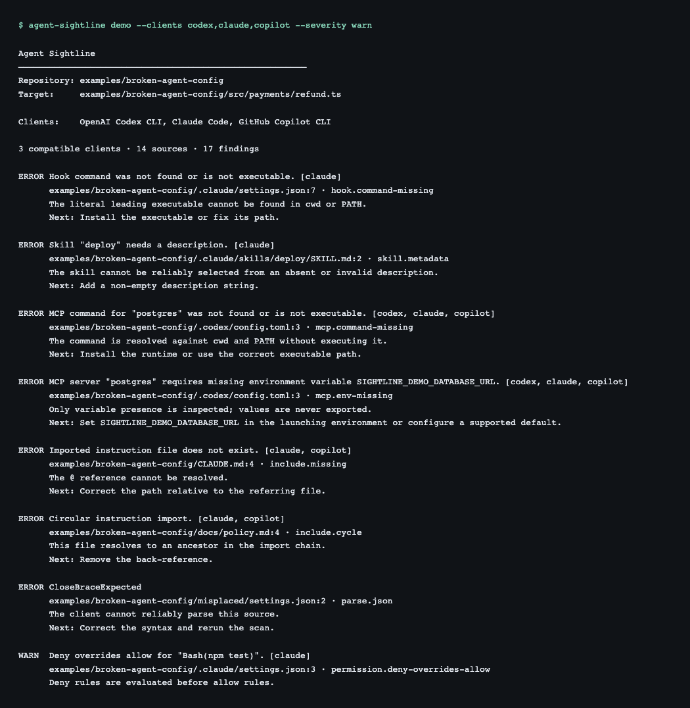
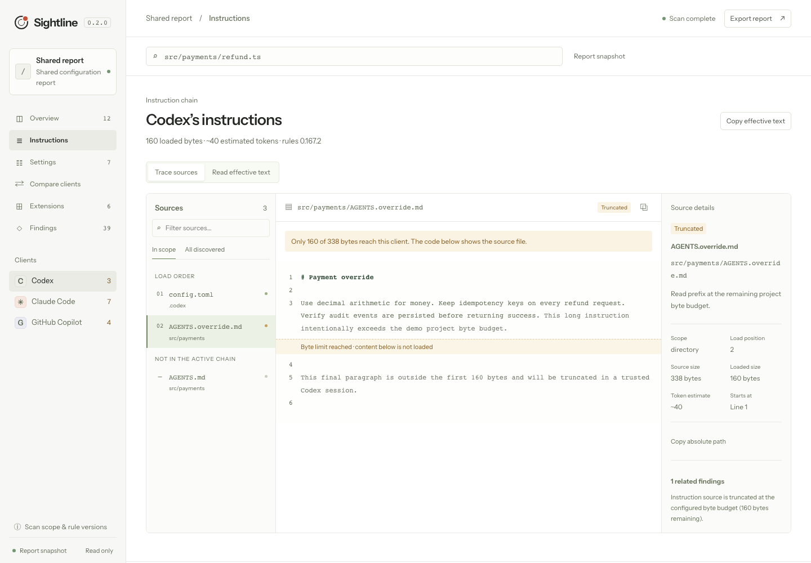

# Agent Sightline

**See what your coding agent actually sees.**

One file. Several agents. Different instructions. Sightline shows every discovered source, why it applies, what is shadowed or truncated, and the effective configuration—with source lines you can inspect.

```sh
npm install -g https://github.com/iamzwxyy/agent-sightline/releases/download/v0.3.2/agent-sightline-0.3.2.tgz
agent-sightline demo --clients codex,claude,copilot --severity warn
agent-sightline demo --ui
```

Node.js 22+. Download and run the package from the public GitHub Release. The website also hosts package downloads. Runtime dependencies are bundled, so a downloaded package installs with `npm install -g --offline ./agent-sightline-0.3.2.tgz`. Public npm-registry publication is pending. [Explore the browser demo](https://iamzwxyy.github.io/agent-sightline/demo/) or read the [installation guide](https://iamzwxyy.github.io/agent-sightline/guide.html).



The demo contains real deterministic failures: a missing instruction import, an import cycle, contradictory allow/deny entries, unavailable MCP and hook commands, missing environment variables, invalid skill metadata and a Codex override that exceeds its byte budget.

```sh
agent-sightline                                      # discover and diagnose this repository
agent-sightline explain src/payments/refund.ts --client codex --trust trusted
agent-sightline diff src/payments/refund.ts --clients codex,claude,copilot --trust trusted
```

Targets can be source files that do not yet exist if their parent directory exists. The explanation models a fresh session launched in the target’s directory and opening that file; it does not claim to observe an already-running agent.

Run these commands from any repository subdirectory. Sightline finds the nearest Git root and includes applicable ancestor instructions and project configuration. Relative targets resolve from your current directory. An explicit `--repo` selects the inspection boundary and resolves targets relative to that directory.

## What it shows

* **Loading proof:** ordered sources with absolute paths, lines, scope, status, reason, loaded bytes and an approximate token cost.
* **Effective inputs:** accumulated instruction bodies, structured setting winners and replaced origins, plus MCP/skill/hook/permission definitions.
* **Deterministic findings:** invalid formats/duplicate keys, override selection, missing/circular/repeated imports, unmatched globs, byte truncation, MCP drift and missing commands/env/cwd, skill conflicts and exact deny masking.
* **Comparison:** instruction content grouped by receiving client, plus extension definitions for each client. No invented natural-language conflict scores.
* **Shareable output:** terminal, stable JSON and a redacted standalone HTML inspector, plus CI finding thresholds.

Select the same Codex profile used in your agent session with `agent-sightline explain src/payments/refund.ts --client codex --profile review --trust trusted`. This loads `$CODEX_HOME/review.config.toml` after user defaults and before project settings, with winning and replaced source lines. The browser inspector also supports selecting and clearing profiles.

## Local inspector

```sh
agent-sightline ui
agent-sightline report --format html --output report.html
agent-sightline ci --no-user --fail-on warn --json
```



The browser UI has client/source navigation, effective content, provenance explanations, client comparison, finding filters and portable HTML export. It binds to `127.0.0.1`; no Electron or hosted service is involved. `--no-open` prints the URL without opening a browser.

The workspace opens with grouped errors and warnings. Select a finding to read its cause and suggested resolution, then jump to the source line. The source explorer shows the original redacted file with line numbers and the byte cutoff. Find target files by name, path or fuzzy query with ⌘K / Ctrl+K. Use arrow keys and Enter to select a result, or inspect a typed path. Filter sources with `/` and inspect client coverage in the comparison matrix. Trust assumptions can be changed from the top bar. Target and trust changes cancel superseded scans and pending configuration reads.

Read effective text shows the exact accumulated instructions with clickable source origins. Compare clients puts those instructions side by side. Settings lets you search resolved values, inspect the selected definition and follow replaced layers. The target and trust choice survive reloads, and browser Back returns through your inspection history. A repository with no configuration opens with a working sample-workspace entry point.

MCP extension details link each configured field to its contributing file and line. A Codex server can inherit its command from user settings and its arguments from a project layer. Findings and terminal explanations retain those separate origins.

The companion website includes an interactive example, a complete installation guide, product walkthroughs and a working CLI package download. Build and preview both interfaces locally with `npm run build:website` followed by `npm run preview`.

## Supported contracts

| Client | Rule target | Status | Focus |
| --- | --- | --- | --- |
| OpenAI Codex CLI | 0.167.2 binary/source/schema | Runtime + fixtures | Instruction chain, trust, overrides, raw-byte budget, TOML layers, selected profile files, MCP, skill metadata, hook discovery |
| Claude Code | 2.1.322 binary + official docs | Native MCP + fixtures | CLAUDE/AGENTS fallback, imports, path rules, settings, MCP transport/scope, skills, hooks, exact permissions |
| GitHub Copilot CLI | 1.0.110 binary + official docs | Native settings/inventory + fixtures | Combined instructions, shared Claude rules/settings, personal aliases and origins, JSONC layers, directional merges, trust, disabled extensions, excluded skill directories, MCP, skills, hooks |
| Gemini CLI | Docs snapshot 2026-11-12 | Experimental | Local settings and global/ancestor/JIT context files |
| Cursor | Docs snapshot 2026-11-12 | Experimental | AGENTS.md and .mdc always/glob/manual/intelligent states, local MCP |
| OpenCode V2 | Docs snapshot 2026-11-12 | Experimental | V2 local configuration and nearest-first AGENTS.md; no V1 fallback assertion |

Codex base/project scalar and MCP values and their winning files are compared with the real 0.167.2 configuration API in twenty-one isolated scenarios. Instruction bodies, profiles and source line numbers retain source/schema fixture coverage. Run `npm run test:codex` to reproduce the configuration comparisons.

Claude MCP transport parsing, approval boundaries, directory behavior and fallback from invalid higher-priority definitions are compared with the pinned 2.1.322 CLI. The checks use temporary homes and synthetic local MCP servers. Other Claude capabilities retain official-document fixtures. Run `npm run test:claude` to reproduce these comparisons.

Copilot settings folds, registered personal aliases, file loading and value types are compared with the native 1.0.110 configuration API. Alias collisions retain the winning original key and earlier source lines. Unknown personal keys produce diagnostics. Its workspace MCP inventory verifies persisted folder trust and disabled servers, and its instruction inventory verifies shared Claude-rule discovery and path metadata. Run `npm run test:copilot` to reproduce these comparisons. Copilot/Claude same-scope settings conflicts retain conditional candidates. Twenty-four native skill-inventory comparisons verify ignored directory roots and eligible same-name fallback. Excluded skills link to their original personal setting in live and portable reports. Additional customization directories mark discovery incomplete, and personal fields outside the fourteen repository-overridable keys retain partial schema coverage.

Rules and known limits are visible through `agent-sightline adapters` and the [evidence ledgers](docs/research/). “Fixture-verified” means the recorded official contracts have executable fixtures; it is not an authenticated live-client conformance claim. Copilot CLI rules differ from VS Code/code review/cloud agent rules.

Client marks are shared across the website, inspector and offline reports. Their sources and upstream notices are recorded in the [visual assets ledger](docs/visual-assets.md).

## Privacy and trust

Default operation is local, read-only, account-free, API-key-free and model-free. No telemetry or uploads. It reads the repository and explicit documented user config locations, marked `user`; use `--no-user` for repository-only CI. It skips external private trees and safely reports damaged config, broken symlinks and access errors.

All public output redacts environment/header values, sensitive keys, common tokens, auth headers and URL credentials; renderers apply redaction again. HTML also replaces captured repository/home paths and verified configuration aliases. Unrecognized paths in prose or shell snippets can remain. Unlabelled arbitrary prose cannot always be identified as a secret; review reports before sharing. See [security policy](SECURITY.md).

Unknown workspace trust remains **conditional**. `--trust trusted` models a trusted session and approved Claude project MCP servers; it changes no real client settings. Default scans start no configured process. `agent-sightline doctor --probe --trust trusted` explicitly starts local stdio MCP servers for initialization/tools listing; startup code can have side effects, and no MCP tool is invoked.

## Install and develop

```sh
npm ci
npm run check
npx playwright install chromium
npm run test:web
npm pack
npm install -g ./agent-sightline-0.3.2.tgz
agent-sightline demo
```

The example is bundled in the installed package. From this checkout, the original explicit path also works:

```sh
agent-sightline examples/broken-agent-config --no-user
```

`npm run check` runs lint, typecheck, parser/resolver/adapter/CLI/report/server/probe tests, native Codex/Claude/Copilot comparisons, build and a real isolated package-install smoke test. GitHub Actions runs these checks plus Chromium browser tests on Linux, macOS and Windows, with desktop Firefox coverage on Linux. See the [executed validation record](docs/validation.md) and its public CI run link for results.

Exit codes: **0** successful inspection, **1** `--fail-on` threshold reached, **2** input/inspection error. CI defaults to JSON and failing on errors. See [CLI contract](docs/cli.md) for flags and JSON structure.

Interrupted scans exit with 130 for SIGINT or 143 for SIGTERM, after active probe processes have stopped.

## Scope and next steps

Sightline diagnoses configuration; it does not synchronize it or switch API providers/models. Markdown guidance accumulates, so the tool does not guess which conflicting sentence an LLM will obey. Source-file diff groups identical bodies rather than doing semantic alignment.

Static reports exclude session toggles, other command-line overrides, account/managed-cloud policy and bundled/plugin state unless expressly supported by an adapter. Experimental adapters describe their gaps rather than claiming complete resolution. Sightline inspects files up to 2 MiB each. Discovery defaults to 50,000 repository entries and 4,000 matching files per user configuration root. Adjust these budgets with `--max-entries` and `--max-user-files`. Reports retain an incomplete-discovery status when limits or inaccessible locations leave sources uninspected, including filtered and exported reports.

The next increments toward v1.0 are broader real-client conformance coverage, plugin/managed-policy provenance and finer paragraph/span comparison. See [architecture](docs/architecture.md), [adapter guide](docs/adapters.md), [contributing](CONTRIBUTING.md), [release procedure](docs/release.md), [30-second demo](docs/demo.md), and [launch drafts](docs/launch-drafts.md).

MIT. Codex schema attribution: [third-party notices](docs/third-party.md).
