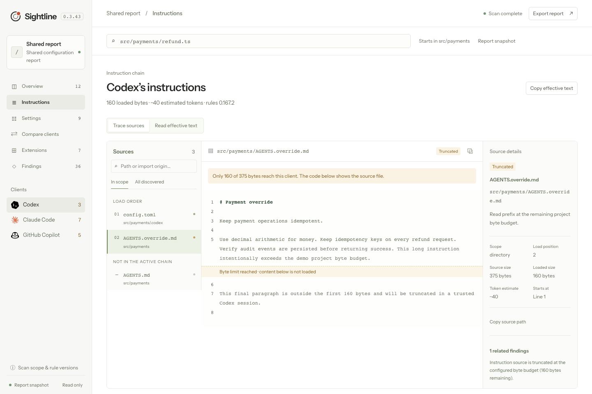

# Agent Sightline

[English](README.md) | [简体中文](README.zh-CN.md) | [日本語](README.ja.md)

**看清编码 Agent 实际读取的配置。**

同一个仓库，Codex、Claude Code 和 GitHub Copilot 可能读取不同的指令、设置与扩展。Sightline 展示配置的加载顺序、生效原因、覆盖关系和来源行，帮助定位配置错误、无效引用与内容截断。

## 在项目中直接使用

需要 Node.js 22 或更高版本。在项目目录打开终端，运行下面的命令。

```sh
npx --yes https://github.com/iamzwxyy/agent-sightline/releases/download/v0.3.46/agent-sightline-0.3.46.tgz ui
```

浏览器会打开本地检查界面。先进入 Findings 查看诊断，选择一条问题阅读原因与修复建议，再点击 Inspect source 跳到来源行。目标文件选择器可以检查仓库内其他文件。界面与诊断正文目前使用英文。

也可以先打开内置示例，体验指令截断、缺失引用、规则覆盖和扩展配置诊断。[浏览器演示](https://iamzwxyy.github.io/agent-sightline/demo/)



## 安装 CLI

重复使用时，可以全局安装，再打开内置示例。

```sh
npm install -g https://github.com/iamzwxyy/agent-sightline/releases/download/v0.3.46/agent-sightline-0.3.46.tgz
agent-sightline demo --ui
```

当前公开安装包通过 GitHub Releases 分发，并包含运行时依赖。下载后可以离线安装。

```sh
npm install -g --offline ./agent-sightline-0.3.46.tgz
```

npm registry 的首次发布待认证。[发布记录与下载](https://github.com/iamzwxyy/agent-sightline/releases)

## 三种常用操作

在项目目录运行下面的命令。

```sh
agent-sightline
agent-sightline explain . --client codex --trust trusted
agent-sightline diff . --clients codex,claude,copilot --trust trusted
```

将 `.` 换成仓库中的目标文件路径，可以检查该文件对应的配置。目标文件的父目录需要存在。默认从目标目录模拟一个新 Agent 会话。在仓库根目录运行时，`--session-dir .` 将 Agent 启动目录固定为根目录。

隐式扫描会查找最近的 Git 根目录，相对目标路径从当前工作目录解析。`--repo` 可以明确指定检查边界。默认读取仓库和已记录的用户配置位置，`--no-user` 选择仅仓库范围。

`--trust trusted` 按仓库已受信任、Claude 项目 MCP 已获批准的假设进行解释。默认 Auto 会保留尚待信任或批准的条件加载状态。浏览器顶栏可切换这个检查假设。

## 对比与分享

Compare clients 可以查看不同客户端收到的有效指令、逐行差异、配置来源与扩展定义。Settings 展示设置的选中值及其覆盖来源。

在诊断详情中，Copy diagnosis 复制经过脱敏的目标、客户端、来源行、原因与修复建议。Export diagnosis report 导出完整 HTML 报告，接收人打开文件时会看到选定的诊断，之后仍可浏览其他来源和对比结果。HTML 内置界面代码和数据，支持离线查看与再次导出。

终端也可以显式导出报告，或按诊断级别决定 CI 的退出状态。

```sh
agent-sightline report --format html --output report.html
agent-sightline ci --no-user --fail-on warn --json
```

CI 默认输出 JSON，并在发现 error 时退出为 1。`--fail-on warn` 将阈值设为 warning。成功检查退出为 0，输入或检查错误退出为 2。[完整 CLI 契约](docs/cli.md)

## 支持范围

| 客户端 | 当前验证范围 |
| --- | --- |
| OpenAI Codex CLI | 已记录规则的原生 CLI 对照与夹具验证 |
| Claude Code | 指令、MCP、权限的原生对照，以及其他已记录规则的夹具验证 |
| GitHub Copilot CLI | 设置、指令与扩展清单的原生对照，以及夹具验证 |
| Gemini CLI | 实验性，包含已发布启动与导入模块的对照 |
| Cursor | 实验性，覆盖已记录的本地规则与 MCP 配置范围 |
| OpenCode V2 | 实验性，覆盖已记录的 V2 本地配置与指令范围 |

验证版本、规则证据与限制可以通过下面的命令查看。[详细支持矩阵](README.md#supported-contracts)

```sh
agent-sightline adapters
```

## 本地运行与隐私

默认扫描在本机只读执行。导出会再次脱敏已识别的私密值，并替换已捕获的仓库、用户目录与配置别名路径。自由文本可能包含尚未识别的敏感内容，分享前请检查报告。[安全说明](SECURITY.md)

检查结果对应选定目录、目标文件与信任假设下的新会话输入。运行中的会话开关、插件和托管策略需要各适配器记录的额外证据。Scan scope & rule versions 可查看具体限制。

旧版 HTML 内置当时的界面代码，重新生成报告可使用新版界面。

## 参与贡献

贡献指南提供按改动类型选择的验证命令，入门任务列出代码入口与验收条件。[贡献指南](CONTRIBUTING.md) · [入门任务](docs/good-first-issues.md)

MIT。[许可证](LICENSE)
