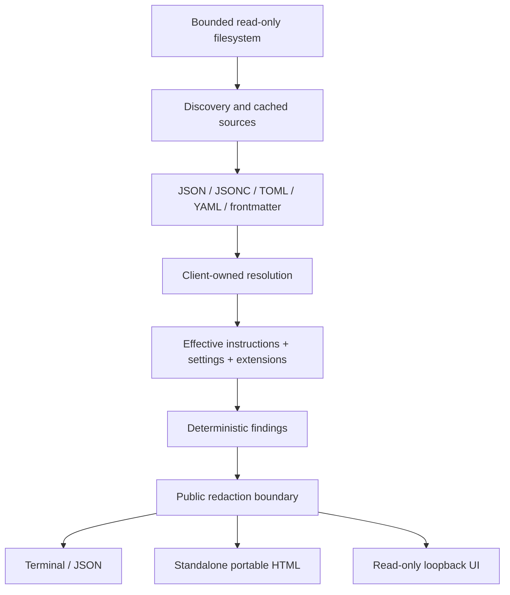

# Architecture

The distribution is a single ESM npm package requiring Node 22+. Internal packages divide responsibilities without a monorepo runtime dependency manager.

`core/discovery.ts` reads known filenames and documented user paths. It caches each logical source path, catches access failures and compares canonical paths for symlink bounds. `parse.ts` retains line maps and refuses duplicate/invalid structured data. Instructions are raw Markdown except rule/skill frontmatter.

An implicit scan finds the nearest ancestor `.git` file or directory, retaining the startup working directory as the target base. Explicit repository selections provide the boundary and target base. The browser resolves and pins its filesystem paths before scanning, so redacted report paths remain presentation data and target navigation stays repository-relative.

Repository enumeration records its actual entry count and budget. Each user rule or skill root counts its own matching files independently of repository sources. Traversal handles deep directories with canonical-path cycle detection and configurable discovery budgets. The additive `discovery` report metadata records whether locations or source contents were skipped by limits or access restrictions. Severity filtering retains that operational status.

Adapters keep client semantics. Codex overlays an explicitly selected user profile file between base user and project configuration, retaining replaced source locations. Retired legacy profile syntax and ignored project-local machine settings have deterministic diagnostics. Codex uses first-existing project candidates, per-directory overrides, trust and a raw-byte project budget. Claude expands bounded imports and matching rules while retaining a separate settings/MCP/skill priority contract. Copilot accumulates instruction files without inventing precedence, deduplicates identical non-modular bodies, and keeps workspace MCP trust conditional.

Codex selects its project root before resolving automatic trust and project configuration. The nearest configured root marker bounds project layers. Without a marker, the session directory is the project root. Trust is read from that root's canonical key with a logical-path fallback.

`tests/codex-runtime.test.ts` compares public `scan()` results with the pinned Codex app-server configuration API in isolated temporary homes and real Git repositories. It checks selected effective scalar/MCP values and winning source files across root, trust and alias cases. The client receives initialization and configuration-read requests. Profiles, instruction content and source line numbers remain covered by source/schema fixtures. The development-only Codex binary is excluded from production archives.

`Decision` records source, scope, state, reason, loading position, raw/loaded bytes and content. `Setting` records a key’s value, winning location and replaced locations. `Extension` records discovered MCP/skill/hook/permission definitions separately from unconditional prompt content. Conditional contributions are visible but excluded from proven `instructions`.

Content diagnostics use the selected client owners for parser findings, field checks and glob validation. MCP shape checks use the clients’ source loading decisions. Shared sources retain diagnostics for each supported selected owner. Discovery coverage and filesystem findings describe the full inspected tree.

Extension validation checks field types before filesystem lookup and process probing. Malformed definitions retain field-specific findings while valid sibling definitions remain inspectable. JSON array entries retain individual line locations for handlers and permission rules. The redaction boundary collects private string leaves from environment and header containers, including malformed containers.

Claude and Copilot MCP environment references are expanded privately for endpoint, working-directory and executable checks. Static validation retains unresolved references while checking independent fields. Explicit probes require complete expansion before startup. Public extension definitions retain their original references.

The scanner captures logical/canonical repository and home roots plus filesystem-verified aliases from absolute structured configuration paths and assigned command-line arguments. Alias discovery uses the redacted diagnostic paths, settings and extension definitions selected by the adapters. Path resolution checks directory metadata without reading additional configuration contents. Additive `Report.pathMappings` survives filtering and JSON serialization. The portable renderer applies those mappings to strings and keys, then removes the mappings. Export uses the context captured in the inspected report, preserving the snapshot through later filesystem edits.

`scan()` returns only redacted public data. The renderers redact again. The report format avoids clocks/timestamps and sorts sources/findings so repeated scans of the same filesystem are stable. Finding IDs hash rule/client/location/message; they remain stable within the same repository path. Relocating a repository changes location-derived IDs.

`ScanOptions.signal` supports cancellation. An interrupted probe finishes child-process cleanup before the scan rejects with the abort reason. POSIX probes own a process group, and Windows probes stop their process tree. Shutdown escalates after a one-second grace period and waits for process closure.

The browser renders source content with `textContent`. One HTML template embeds CSS, JS and escaped JSON. It serves both offline reports and the live read-only UI. Local endpoints accept GET only and recheck repository bounds for target requests.

Live pages include a portable HTML export produced from their initial report. Browser scan requests use `include=html` to receive the redacted report and its portable HTML together. The browser replaces both after a successful current request and retains them during pending or failed refreshes. Export downloads the retained snapshot, preserving the inspected contents across subsequent disk edits. The default scan and export endpoints retain their existing response formats.

Resolution uses the target parent as the assumed session directory. This is a static view of documented inputs, not an inspection of an already-running agent transcript. Session toggles, command-line overrides, remote policy, bundled plugins and model decisions require future explicit inputs/integration.
